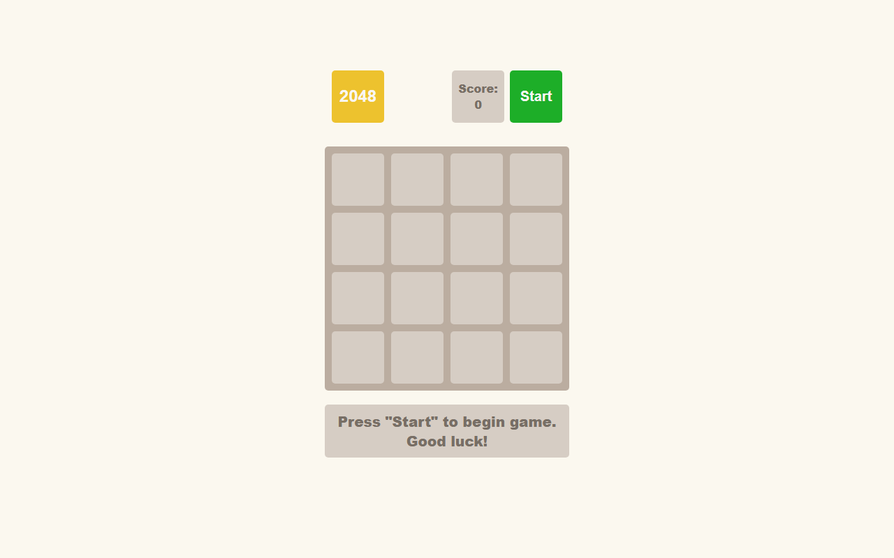

# 2048 Game

Browser version of the classic 2048 puzzle, written in vanilla JavaScript.

**[▶ Live demo](https://natakovbasniuk.github.io/js_2048_game/)**



## What I implemented
- Game logic: moving and merging tiles in four directions on a 4×4 board
- Keyboard controls with the arrow keys
- Score counter, win state (2048 tile) and lose state (no moves left)
- Start and restart buttons, status messages

## Tech stack
JavaScript (ES6+), DOM, HTML5, CSS3

## Run locally
```bash
npm install
npm start
```

---
Course project at [Mate Academy](https://mate.academy): the task and layout were provided by the course, the game logic is my implementation.
